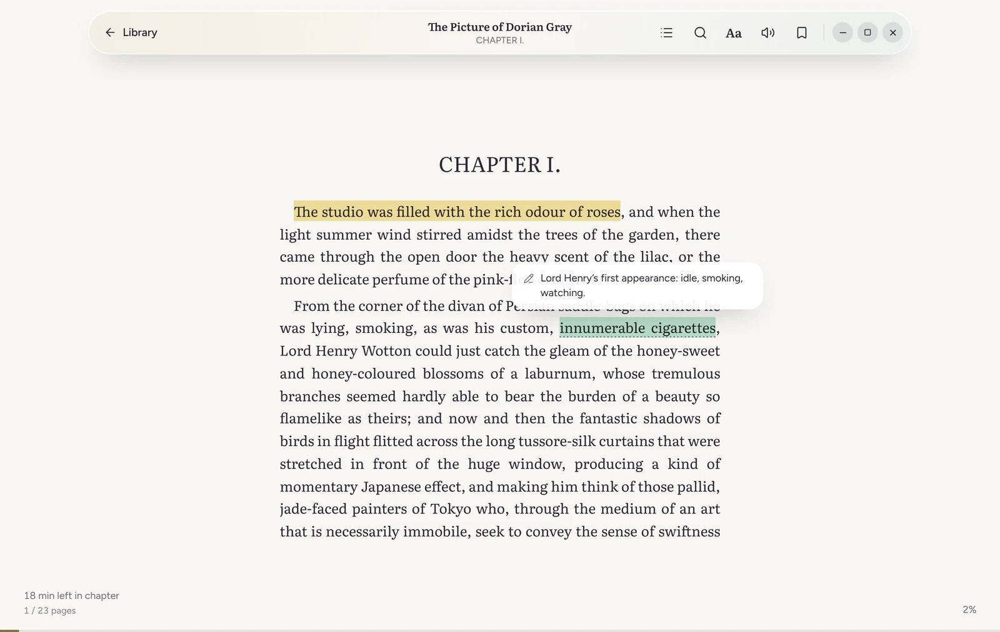
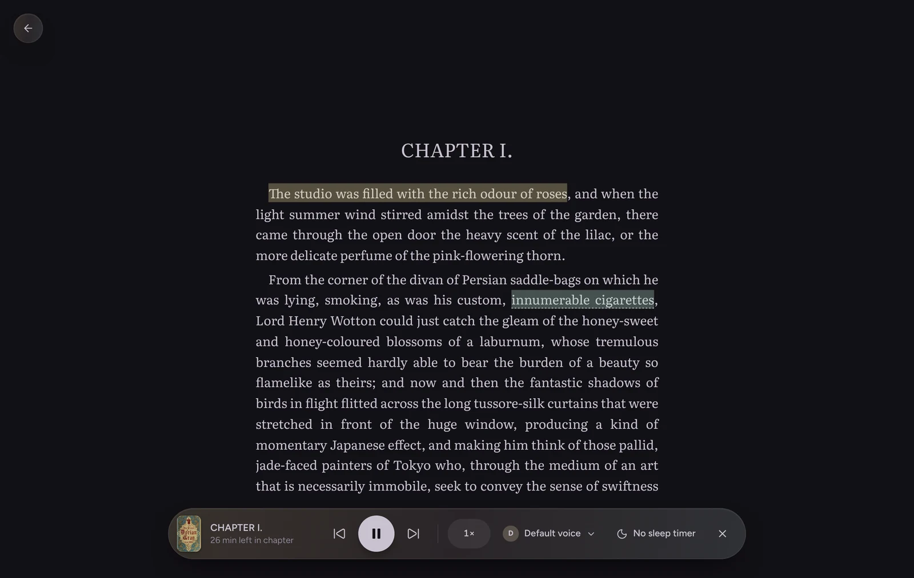
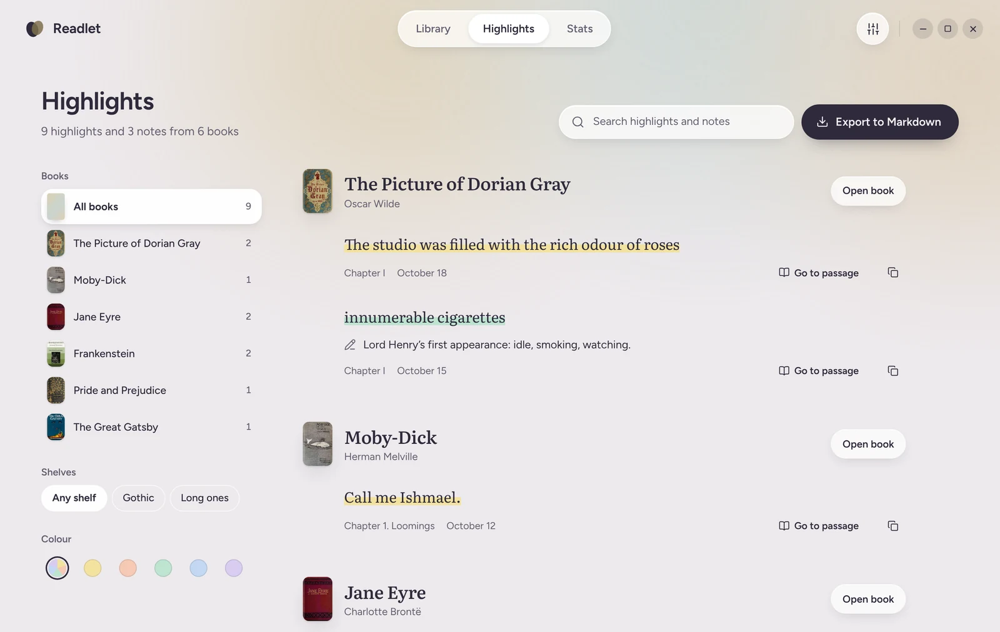

# Readlet

E-reader for Linux and Android. Built with Tauri 2, React and
[foliate-js](https://github.com/johnfactotum/foliate-js).


## Features

- Library with search, sorting, series, shelves, reading status and book details
- Editable book details and covers, with lookup on Open Library
- Formats: EPUB, MOBI, AZW3, FB2, CBZ and PDF (experimental); no DRM support
- Paginated or scrolled reader, two-page spreads, table of contents, in-book search, four themes,
  adjustable fonts and spacing
- Highlights in five colours, notes, bookmarks, Wiktionary lookup, Markdown export
- Reading stats: time, streaks, speed and goals
- Read-aloud via Speech Dispatcher (Linux) or the system TTS engine (Android), with a sleep timer
- PDF and comic zoom with a view lock
- Android: keep-awake while reading, volume keys for page turns, lock-screen playback controls

|                                                 |                                                 |
| ----------------------------------------------- | ----------------------------------------------- |
|          |  |
|  |            |

## Data

Readlet reads books from a folder and stores progress, highlights and stats in `.readlet/` inside
it. Each device writes only to its own subdirectory and all of them are merged on read, so the
folder can be synced with Syncthing, Nextcloud or similar without conflicts. Book files are never
modified: edited details and chosen covers are stored in `.readlet/` too. Books are identified by a content fingerprint, so renaming or moving a file keeps its
data. The SQLite index in the app data directory is a cache and can be rebuilt from the folder.

Readlet only goes online when asked: Wiktionary for word lookups (once enabled in Settings), and
Open Library when you search for a book's details.

## Install

Packages (`.deb`, `.rpm`, AppImage, Android APK) are published as the `main-build` pre-release on
the Releases page.

**Linux:** read-aloud needs Speech Dispatcher and a voice (`sudo dnf install speech-dispatcher
espeak-ng` on Fedora). The AppImage does not install them.

**Android:** requires Android 11 or newer. The app asks for _All files access_ to read the books
folder. Read-aloud uses the text-to-speech engine set in the system settings. The library is
rescanned when the app returns to the foreground.

## Development

Requires Rust 1.88+, [bun](https://bun.sh) and
[Tauri's system libraries](https://v2.tauri.app/start/prerequisites/). On Fedora:

```sh
sudo dnf install webkit2gtk4.1-devel openssl-devel curl wget file libappindicator-gtk3-devel \
  librsvg2-devel libxdo-devel
sudo dnf group install c-development
```

```sh
git clone --recurse-submodules https://github.com/Mischou01/Readlet
cd Readlet
bun install
bun tauri dev                                    # run with hot reload
bun run check                                    # types, lint, formatting, UI tests
cargo test --manifest-path src-tauri/Cargo.toml
bun tauri build                                  # release build and packages
```

For Android, install the SDK, NDK and JDK 17+ and set `ANDROID_HOME` and `NDK_HOME`:

```sh
rustup target add aarch64-linux-android
bun tauri android dev
bun tauri android build --apk --target aarch64
```

See [docs/PLAN.md](docs/PLAN.md) for the architecture and [docs/SIGNING.md](docs/SIGNING.md) for
signing release APKs.

## License

GPL-3.0-or-later. See [LICENSE](LICENSE). Third-party licenses: foliate-js (MIT), pdf.js
(Apache-2.0), Figtree, Literata, Newsreader and Atkinson Hyperlegible Next (SIL OFL), Lucide
(ISC).
